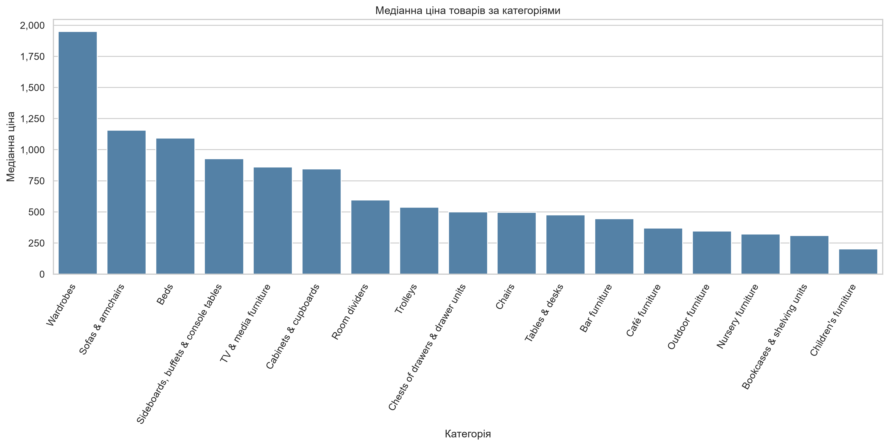
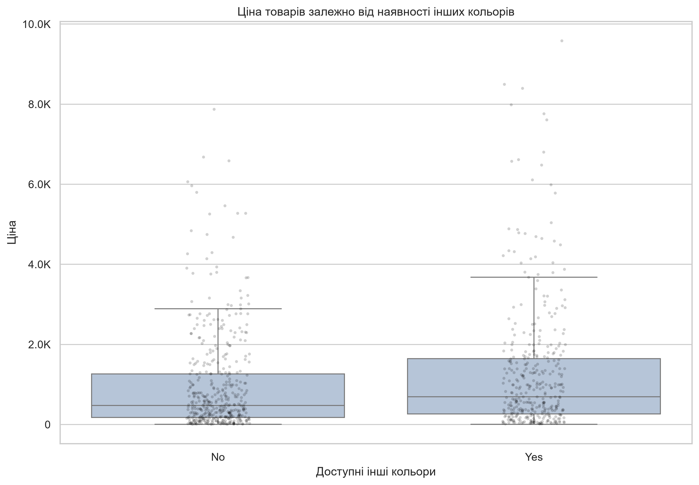
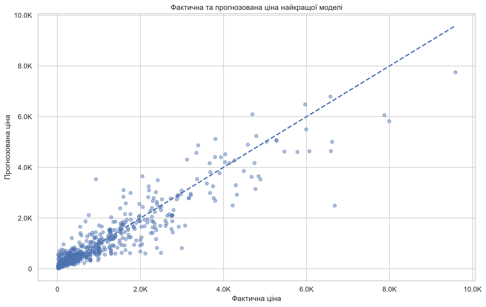

# IKEA Furniture Price Analysis | Python

**Data Analytics course project · DAN.IT Education (2026)**  
*Exploratory data analysis · Statistical testing · Regression modelling*

## Project at a glance

This project analyzes historical IKEA furniture listings to understand how prices vary across categories and product characteristics, then evaluates models for predicting listed product prices. It is a **training project**, not a live retail forecasting or production ML system.

- **Dataset:** 2,962 product records after cleaning, across 17 categories
- **Best model:** Random Forest with GridSearchCV tuning
- **Held-out test R²:** 0.853
- **Test MAE:** 321.18 SAR | **RMSE:** 526.65 SAR

## Data source

[TidyTuesday — IKEA Furniture (2020-11-03)](https://github.com/rfordatascience/tidytuesday/tree/main/data/2020/2020-11-03), based on a historical IKEA Saudi Arabia product-listing dataset. Prices are in **Saudi riyals (SAR)**. This is not current sales, transaction, or market data. The script downloads the public CSV automatically on first run.

## Approach

1. **Clean and prepare data:** examine duplicates and missing values, clean designer names, parse previous prices, and build text and dimension-based features.
2. **Explore the dataset:** compare product categories, price distributions, designer information and product dimensions using summary statistics and visualizations.
3. **Test hypotheses:** compare price distributions for products with and without additional colour options; test associations between product volume and listed price using rank correlations and logarithmic analysis.
4. **Model prices:** compare Ridge Regression, Decision Tree, Random Forest and Gradient Boosting; use `Pipeline`, `ColumnTransformer`, train/test split, cross-validation and `GridSearchCV`.
5. **Evaluate:** report R², MAE, RMSE and feature importance on a held-out test set.

## Selected findings

| Finding | Verified result | Interpretation |
|---|---:|---|
| Median listed price across cleaned records | **570 SAR** | Typical price in this historical product sample |
| Products with additional colour options | **695 SAR** median (n=1,325) | Higher unadjusted median price than products without additional colours |
| Products without additional colour options | **476 SAR** median (n=1,637) | Difference between group medians: **219 SAR** |
| Median-difference permutation test | **p=0.0002** | Evidence of a difference between the groups; **not causal** |
| Volume–price association | **Spearman ρ=0.845** (n=1,602) | Strong positive association among products with valid dimensions |

Colour availability and price may both depend on product category, size, or other factors. The group comparison is **descriptive, not a causal estimate**.

### Regression model comparison

| Model | Held-out test R² | MAE (SAR) | RMSE (SAR) |
|---|---:|---:|---:|
| Random Forest baseline | 0.838 | 334.44 | 552.88 |
| Random Forest after GridSearchCV | **0.853** | **321.18** | **526.65** |

Four model families were compared using cross-validation on the training split. Random Forest had the strongest baseline cross-validation performance and was selected for hyperparameter tuning. The final test set was held out from the tuning process.

The tuned Random Forest relied most heavily on **width (49.2%)**, **depth (16.5%)** and **designer (13.4%)** based on the model's feature-importance measure. These values indicate predictive importance within this fitted model; they do **not** establish causal effects.

## Visualizations

**Listed prices by category**  


**Prices by availability of additional colour options**  


**Observed versus predicted prices (held-out test set)**  


Additional charts:
- [Price and dimensional-feature correlations](figures/06_price_dimensions_correlation.png)
- [Log-transformed volume and price](figures/18_hypothesis_2_volume_price.png)
- [Baseline cross-validation model comparison](figures/19_baseline_model_comparison.png)
- [Random Forest feature importance](figures/22_feature_importance.png)

*Chart labels reflect the original Ukrainian-language course submission.*

## Repository structure

```text
IKEA_Final_Project.py          Full analysis script
README.md                      Overview, evidence and conclusions
requirements.txt               Python packages
.gitignore                     Local-file exclusions
figures/                       Seven selected plots
results/                       Four original model/statistical result tables (CSV)
```

The `results/` tables are CSV files that also open in Microsoft Excel. All figures and tables are outputs from the submitted project. Large model artifacts, the full cleaned data export and redundant figures are intentionally excluded from GitHub.

## Run locally

```bash
python -m pip install -r requirements.txt
python IKEA_Final_Project.py
```

The script downloads the source CSV if needed and writes its output to `ikea_final_project_results/`. Full execution performs statistical resampling and multiple model-training runs and can take time. An internet connection is needed for the first download.

## Limitations

- This dataset describes **historical listed prices**, not realized sales or future price movements.
- Observed relationships may be confounded by product category or other characteristics; **correlation is not causation**.
- Test performance is specific to this sample and modelling setup; no production or out-of-time validation is claimed.
- The MAE and RMSE show that individual predictions can still differ substantially from actual prices, especially for expensive or unusual products.

---
*Course project by Larysa Kulihina · DAN.IT Education, 2026*
